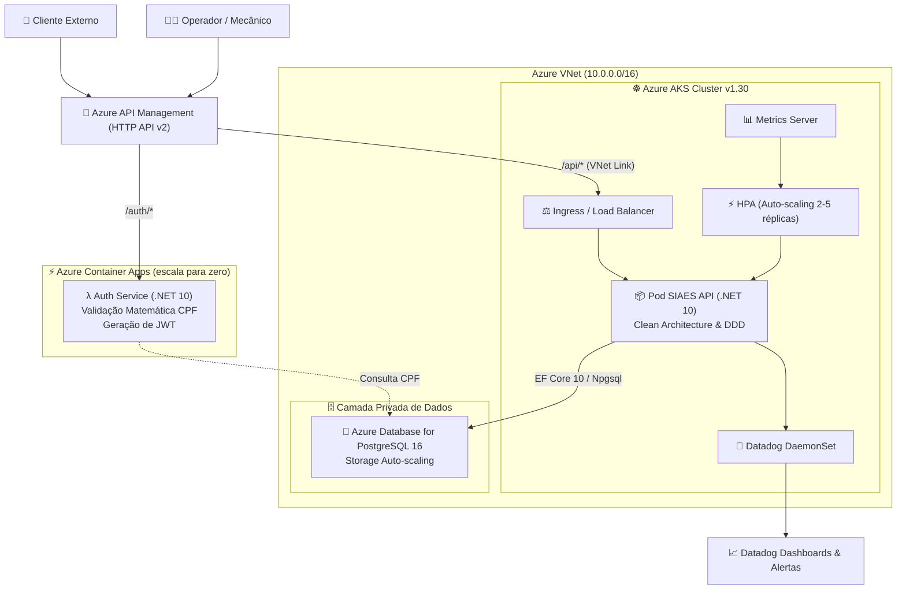
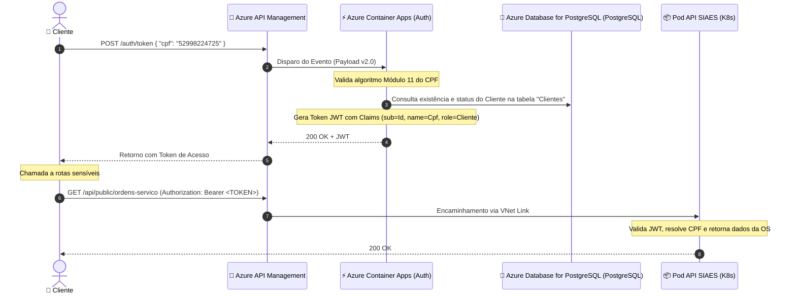

# Oficina Mecânica - Tech Challenge FIAP (Fase 3)

## SIAES - Sistema Integrado de Atendimento e Execução de Serviços

Este repositório contém a **aplicação principal executando em Kubernetes** para o **SIAES (Sistema Integrado de Atendimento e Execução de Serviços)**, desenvolvido para a gestão de uma oficina mecânica de nível corporativo.

Na **Fase 3**, o ecossistema foi elevado a um nível de operação corporativa com práticas avançadas de **Cloud Computing**, **Autenticação Serverless via CPF**, **API Management**, segregação em **quatro repositórios independentes**, **Banco de Dados Gerenciado (Azure Database for PostgreSQL)**, **Cluster Kubernetes Elástico (Azure AKS)** com **Horizontal Pod Autoscaler (HPA)** e **Observabilidade & Monitoramento Unificado (Datadog & Azure Monitor)**.

## 🏛️ Estrutura de Repositórios da Fase 3

Atendendo aos requisitos obrigatórios da Fase 3, o projeto está estruturado em **quatro repositórios independentes**, cada um com sua esteira de **CI/CD** e automação:

| Repositório                                                                                                    | Descrição                                                                                                    | Tecnologias                                                               | CI/CD          |
| :------------------------------------------------------------------------------------------------------------- | :----------------------------------------------------------------------------------------------------------- | :------------------------------------------------------------------------ | :------------- |
| [**`FIAP.Tech.Challenge.Lambda`**](https://github.com/dvdalves/FIAP.Tech.Challenge.Lambda)                     | Function Serverless para validação de CPF (Módulo 11), consulta ao banco e emissão de tokens JWT.            | .NET 10, C# 13, Azure Container Apps, API Management v2, Npgsql, Docker, Terraform     | GitHub Actions |
| [**`FIAP.Tech.Challenge.Infra.Kubernetes`**](https://github.com/dvdalves/FIAP.Tech.Challenge.Infra.Kubernetes) | IaC para provisionamento de VNet zone-redundant, Cluster Azure AKS v1.30, Node Groups, API Management central e Datadog. | Terraform >= 1.5.0, Azure AKS, Azure VNet, Helm, Datadog Agent, Metrics Server | GitHub Actions |
| [**`FIAP.Tech.Challenge.Infra.Database`**](https://github.com/dvdalves/FIAP.Tech.Challenge.Infra.Database)     | IaC para provisionamento do Azure Database for PostgreSQL 16, Key Vault e scripts SQL versionados de DDL e Seed.  | Terraform >= 1.5.0, Azure Database for PostgreSQL 16, Azure Key Vault, SQL       | GitHub Actions |
| [**`FIAP.Tech.Challenge`**](https://github.com/dvdalves/FIAP.Tech.Challenge) _(este repositório)_              | Aplicação principal em contêineres executando no Kubernetes (Clean Architecture & DDD).                      | .NET 10, C# 13, EF Core, Kubernetes, Kustomize, HPA, SonarQube            | GitHub Actions |

---

## 🧭 Menu de Navegação

- [1. Documentação Arquitetural Completa (Fase 3)](#1-documentação-arquitetural-completa-fase-3)
- [2. Desenho da Arquitetura Proposta](#2-desenho-da-arquitetura-proposta)
  - [2.1. Visão de Nuvem, APIs, Banco e Monitoramento](#21-visão-de-nuvem-apis-banco-e-monitoramento)
  - [2.2. Fluxo de Autenticação Serverless via CPF e JWT](#22-fluxo-de-autenticação-serverless-via-cpf-e-jwt)
  - [2.3. Arquitetura da Aplicação (Clean Architecture & DDD)](#23-arquitetura-da-aplicação-clean-architecture--ddd)
- [3. Como Executar a Aplicação](#3-como-executar-a-aplicação)
  - [3.1. Execução Local via Docker Compose (Recomendado)](#31-execução-local-via-docker-compose-recomendado)
  - [3.2. Deploy em Cluster Kubernetes (K8s)](#32-deploy-em-cluster-kubernetes-k8s)
  - [3.3. Execução dos Testes Automatizados](#33-execução-dos-testes-automatizados)
- [4. Orquestração e Escalabilidade (Kubernetes & HPA)](#4-orquestração-e-escalabilidade-kubernetes--hpa)
- [5. Monitoramento e Observabilidade (Datadog & Azure Monitor)](#5-monitoramento-e-observabilidade-datadog--azure-monitor)
- [6. Qualidade, Testes e SonarQube](#6-qualidade-testes-e-sonarqube)
- [7. Coleções de Teste de API (Postman & Swagger)](#7-coleções-de-teste-de-api-postman--swagger)

---

## 1. Documentação Arquitetural Completa (Fase 3)

A documentação arquitetural exigida pela Fase 3 está organizada no diretório [`docs/Fase 3/`](docs/Fase%203/):

- 📘 [**Documentação Arquitetural Completa (Master)**](docs/Fase%203/documentacao_arquitetural.md): Hub unificado contendo o diagrama de componentes na nuvem, diagramas de sequência de autenticação e abertura de OS, topologia de rede e checklist de conformidade.
- 🗄️ [**Modelagem do Banco de Dados Relacional & Justificativa Técnica**](docs/Fase%203/modelagem_banco_dados.md): Justificativa formal da escolha do PostgreSQL 16 no Azure Database for PostgreSQL, Diagrama Entidade-Relacionamento (ERD) completo, dicionário de dados e análise de transações ACID.
- 📄 **RFCs (Request for Comments) - Decisões Técnicas**:
  - [RFC 001: Escolha do Provedor de Nuvem Pública (Azure)](docs/Fase%203/rfcs/RFC-001-escolha-do-provedor-de-nuvem-azure.md)
  - [RFC 002: Escolha do Banco de Dados Gerenciado (PostgreSQL no PostgreSQL Flexível)](docs/Fase%203/rfcs/RFC-002-escolha-do-banco-de-dados-gerenciado-postgresql-azure.md)
  - [RFC 003: Estratégia de Autenticação Serverless por CPF e Emissão de JWT](docs/Fase%203/rfcs/RFC-003-estrategia-de-autenticacao-serverless-jwt.md)
- 📐 **ADRs (Architecture Decision Records) - Decisões Permanentes**:
  - [ADR 001: Segregação em 4 Repositórios Independentes com CI/CD Desacoplado](docs/Fase%203/adrs/ADR-001-segregacao-em-quatro-repositorios-e-cicd.md)
  - [ADR 002: Padrão de Comunicação e Roteamento via Azure API Management](docs/Fase%203/adrs/ADR-002-padrao-de-comunicacao-e-roteamento-api-management.md)
  - [ADR 003: Escalabilidade Dinâmica com HPA e Metrics Server](docs/Fase%203/adrs/ADR-003-escalabilidade-dinamica-com-hpa-e-metrics-server.md)
  - [ADR 004: Estratégia de Observabilidade, Tracing Distribuído e Logs Estruturados](docs/Fase%203/adrs/ADR-004-estrategia-de-observabilidade-e-monitoramento.md)

---

## 2. Desenho da Arquitetura Proposta

### 2.1. Visão de Nuvem, APIs, Banco e Monitoramento



### 2.2. Fluxo de Autenticação Serverless via CPF e JWT



### 2.3. Arquitetura da Aplicação (Clean Architecture & DDD)

A aplicação principal é organizada como um **Monolito Coeso**, seguindo rigorosamente os preceitos de **Clean Architecture** e **Domain-Driven Design (DDD)**:

```text
src/
├── FIAP.Tech.Challenge.Domain/         # Entidades ricas, Agregados, VOs, Exceções de Domínio
├── FIAP.Tech.Challenge.Application/    # Casos de uso, DTOs, Mapeamentos e Validadores
├── FIAP.Tech.Challenge.Infrastructure/ # EF Core 10, Npgsql, Mapeamentos Fluent API e Repositórios
└── FIAP.Tech.Challenge.API/            # Controllers REST, Middleware JWT, Swagger e Filtro Global
tests/
├── FIAP.Tech.Challenge.UnitTests/      # Testes unitários de Domínio, VOs e Casos de Uso
└── FIAP.Tech.Challenge.IntegrationTests/# Testes integrados com WebApplicationFactory e InMemory
```

---

## 3. Como Executar a Aplicação

### 📋 Pré-requisitos

- [Docker Desktop](https://www.docker.com/products/docker-desktop/) (com suporte a `docker compose` e Kubernetes local).
- [.NET 10 SDK](https://dotnet.microsoft.com/download/dotnet/10.0) (para compilação local e execução de testes).
- [kubectl](https://kubernetes.io/docs/tasks/tools/) e [Terraform CLI](https://developer.hashicorp.com/terraform/downloads).

---

### 3.1. Execução Local via Docker Compose (Recomendado)

O ambiente completo (API .NET 10, PostgreSQL 18 e SonarQube) é inicializado de forma orquestrada com verificação de integridade (_healthcheck_):

```bash
docker compose up --build
```

- **API & Swagger**: `http://localhost:8080` (redireciona automaticamente para `/swagger`).
- **Health Check da Aplicação**: `http://localhost:8080/health`.
- **SonarQube**: `http://localhost:9000` (usuário: `admin` / senha inicial: `admin`).

---

### 3.2. Deploy em Cluster Kubernetes (K8s)

Os manifestos declarativos estão localizados no diretório [`k8s/`](k8s/) e são orquestrados via Kustomize:

```bash
# 1. Aplicar todos os recursos no cluster (Namespace, ConfigMaps, Secrets, PVC, Postgres, API e HPA)
kubectl apply -k k8s/

# 2. Verificar o status dos pods e serviços no namespace da oficina
kubectl get pods,services,hpa -n oficina
```

Para acessar a API exposta pelo NodePort do Kubernetes:

- **URL**: `http://localhost:30080` (ou IP do Node no NodePort `30080`).

---

### 3.3. Execução dos Testes Automatizados

A suíte conta com **145 testes automatizados** cobrindo regras de negócio, invariantes de domínio, transições de status da OS, cálculo atômico de orçamentos, baixa transacional de estoque e chamadas REST:

```bash
dotnet test --verbosity normal
```

---

## 4. Orquestração e Escalabilidade (Kubernetes & HPA)

Os manifestos em [`k8s/`](k8s/) garantem alta disponibilidade e escalabilidade dinâmica:

- **Zero Downtime**: Estratégia `RollingUpdate` garantindo substituição progressiva de pods.
- **Probes de Confiabilidade**: `livenessProbe` e `readinessProbe` no endpoint `/health`.
- **Gerenciamento de Recursos**: Definição de `requests` (`cpu: 100m`, `memory: 128Mi`) e `limits` (`cpu: 500m`, `memory: 512Mi`).
- **Horizontal Pod Autoscaler (HPA)**:
  - Escala automaticamente de **2 réplicas mínimas** até **5 réplicas máximas**.
  - Gatilhos de autoescalabilidade: **70% de consumo médio de CPU** ou **80% de consumo médio de memória**.
- **Configuração Segura**: Segredos de banco e JWT isolados em `Secret` e parâmetros em `ConfigMap`.

---

## 5. Monitoramento e Observabilidade (Datadog & Azure Monitor)

### Ambiente local com Aspire e PostgreSQL

O ambiente local usa o mesmo mecanismo de banco da nuvem: PostgreSQL. O Aspire
orquestra o container PostgreSQL, cria a base `oficina`, injeta a connection
string na API e exibe o dashboard local de recursos, logs e traces.

Pré-requisitos: .NET 10 e Aspire CLI.

```bash
aspire secret set Parameters:postgres-password "senha-local-do-postgres"
aspire secret set Parameters:jwt-secret "chave-local-do-aspire"
aspire start --apphost src/FIAP.Tech.Challenge.AppHost
```

O projeto `FIAP.Tech.Challenge.AppHost` gerencia a API completa, o PostgreSQL,
as dependências, health checks e a integração de telemetria com o dashboard.
As senhas ficam persistidas nos User Secrets do AppHost e não precisam ser
informadas novamente a cada inicialização.
A API aplica automaticamente as migrations PostgreSQL antes de aceitar tráfego.

### Migrações automáticas do banco

O perfil local usa PostgreSQL provisionado pelo Aspire e o ambiente de nuvem usa
Azure Database for PostgreSQL. Ambos aplicam automaticamente as migrations do
EF Core na inicialização da API.
As migrations são separadas por provedor em
`src/FIAP.Tech.Challenge.Infrastructure/Data/Migrations/`.

Para executar a API diretamente, usando PostgreSQL local:

```bash
JWT_SECRET_KEY="chave-local" \
DbProvider=PostgreSQL \
ConnectionStrings__DefaultConnection="Host=localhost;Port=5432;Database=oficina;Username=postgres;Password=postgres" \
dotnet run --project src/FIAP.Tech.Challenge.API
```

Em produção, configure `DbProvider=PostgreSQL` e a connection string via
secret/Key Vault. A API executa `Database.Migrate()` antes de aceitar tráfego.

Atendendo aos requisitos da **Fase 3**, o monitoramento contempla:

- **Latência das APIs**: Medição dos percentis p50, p95 e p99 para rotas de abertura de OS e autenticação.
- **Consumo de Recursos**: Alertas de saturação de CPU e memória em nós e pods.
- **Logs Estruturados (JSON)**: Ingestão de logs contendo correlação entre requisições via `TraceId` e `SpanId`.
- **Dashboards Operacionais no Datadog**:
  - Volume diário de ordens de serviço (abertas, aprovadas e finalizadas);
  - Tempo médio de execução por status (Diagnóstico, Execução e Finalização);
  - Erros e falhas nas integrações (taxas 4xx e 5xx).

---

## 6. Qualidade, Testes e SonarQube

- **Testes Automatizados**: 100% de cobertura nos fluxos críticos de negócio.
- **Análise Estática de Código (SAST & SCA)**: Zero vulnerabilidades e code smells.
- **Execução do SonarQube Local**:

  ```bash
  # 1. Subir o SonarQube
  docker compose up -d sonarqube

  # 2. Executar script de análise com envio de métricas de cobertura
  ./run-sonar.sh
  ```

---

## 7. Coleções de Teste de API (Postman & Swagger)

- **Swagger Interativo**: Disponível em `http://localhost:8080/swagger` com suporte completo a Bearer JWT.
- **Postman Collection**: Arquivo [`OficinaMecanica.postman_collection.json`](OficinaMecanica.postman_collection.json) contendo o fluxo completo de testes sequenciais.
- **API Reference**: Guia detalhado de endpoints em [`docs/api_reference.md`](docs/api_reference.md).
