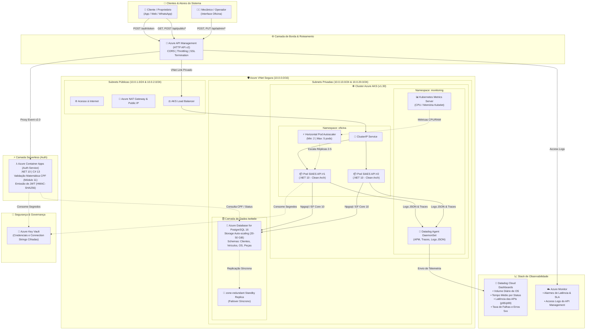
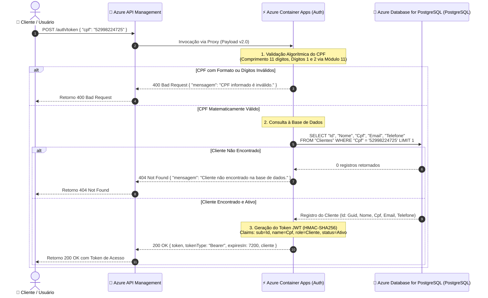
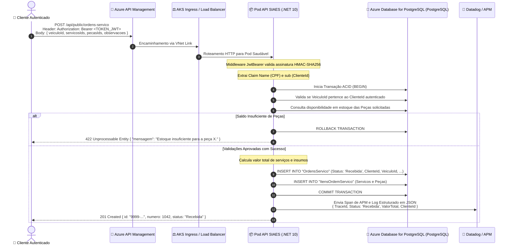

# Documentação Arquitetural Completa - SIAES (Fase 3)

## Sistema Integrado de Atendimento e Execução de Serviços (Oficina Mecânica)
### Pós-Graduação em Arquitetura de Sistemas - FIAP (Tech Challenge SOAT)

---

## 🧭 Sumário

1. [Visão Geral da Arquitetura (Fase 3)](#1-visão-geral-da-arquitetura-fase-3)
2. [Diagrama de Componentes (Nuvem, APIs, Banco e Monitoramento)](#2-diagrama-de-componentes-nuvem-apis-banco-e-monitoramento)
3. [Diagramas de Sequência](#3-diagramas-de-sequência)
   - [Fluxo 1: Autenticação Serverless via CPF e Emissão de Token JWT](#fluxo-1-autenticação-serverless-via-cpf-e-emissão-de-token-jwt)
   - [Fluxo 2: Abertura e Processamento de Ordem de Serviço](#fluxo-2-abertura-e-processamento-de-ordem-de-serviço)
4. [RFCs (Request for Comments) - Decisões Técnicas Relevantes](#4-rfcs-request-for-comments---decisões-técnicas-relevantes)
5. [ADRs (Architecture Decision Records) - Decisões Arquiteturais Permanentes](#5-adrs-architecture-decision-records---decisões-arquiteturais-permanentes)
6. [Modelagem do Banco de Dados e Justificativa Relacional](#6-modelagem-do-banco-de-dados-e-justificativa-relacional)
7. [Segregação em 4 Repositórios e CI/CD](#7-segregação-em-4-repositórios-e-cicd)
8. [Estratégia de Monitoramento e Observabilidade](#8-estratégia-de-monitoramento-e-observabilidade)
9. [Checklist de Conformidade com o Tech Challenge](#9-checklist-de-conformidade-com-o-tech-challenge)

---

## 1. Visão Geral da Arquitetura (Fase 3)

Com a expansão da oficina mecânica para múltiplas filiais e o expressivo crescimento da base de clientes e frotas corporativas atendidas, a arquitetura foi promovida para uma operação de **nível corporativo**. 

A solução adota os seguintes pilares estratégicos:
* **Computação Serverless na Borda**: Desacoplamento da autenticação através de uma Function Serverless (Azure Container Apps) sob demanda;
* **Roteamento Centralizado**: Ponto de entrada unificado com Azure API Management (HTTP API v2) gerenciando segurança, políticas de CORS e vazão;
* **Orquestração de Contêineres com Elasticidade**: Aplicação principal em cluster gerenciado Kubernetes (Azure AKS v1.30) com autoescalonamento horizontal (HPA);
* **Persistência Relacional Gerenciada**: Instância Azure Database for PostgreSQL 16 isolada em rede privada com replicação zone-redundant e garantias ACID estritas;
* **Observabilidade Unificada**: Telemetria ponta a ponta com **Datadog** (APM, traces distribuídos, métricas e dashboards de negócio) e **Azure Monitor**.

---

## 2. Diagrama de Componentes (Nuvem, APIs, Banco e Monitoramento)

O diagrama a seguir apresenta a visão completa da arquitetura na nuvem Azure, demonstrando a interação entre os componentes de borda, orquestração, banco gerenciado e observabilidade:

---

## 3. Diagramas de Sequência

### Fluxo 1: Autenticação Serverless via CPF e Emissão de Token JWT

Demonstra a proteção de rotas através da validação algorítmica de CPF, consulta ao banco gerenciado e devolução do token JWT com claims enriquecidas:

---

### Fluxo 2: Abertura e Processamento de Ordem de Serviço

Demonstra o consumo de endpoints protegidos por JWT, verificação de claims, validação de regras de negócio de domínio e baixa transacional com rastreabilidade completa:

---

## 4. RFCs (Request for Comments) - Decisões Técnicas Relevantes

As decisões que exigiram análise comparativa técnica entre alternativas foram formalizadas através de RFCs versionadas:

| Documento | Título da RFC | Decisão Aprovada |
| :--- | :--- | :--- |
| [**RFC 001**](docs/Fase%203/rfcs/RFC-001-escolha-do-provedor-de-nuvem-azure.md) | **Escolha do Provedor de Nuvem Pública (Azure)** | Adoção do Azure pela integração entre AKS, PostgreSQL Flexible Server, Container Apps, API Management e Terraform `hashicorp/azurerm`. |
| [**RFC 002**](docs/Fase%203/rfcs/RFC-002-escolha-do-banco-de-dados-gerenciado-postgresql-azure.md) | **Escolha do Banco de Dados Gerenciado (PostgreSQL no PostgreSQL Flexível)** | Adoção do **PostgreSQL 16** no Azure Database for PostgreSQL garantindo propriedades ACID para baixa atômica de estoque e aprovação financeira, integridade referencial nativa e índices B-Tree de alta performance. |
| [**RFC 003**](docs/Fase%203/rfcs/RFC-003-estrategia-de-autenticacao-serverless-jwt.md) | **Estratégia de Autenticação Serverless por CPF e Emissão de JWT** | Implementação de **Function Serverless (Azure Container Apps)** em .NET 10 na borda via API Management, validando CPF via Módulo 11 e gerando tokens JWT compatíveis com a aplicação principal. |

---

## 5. ADRs (Architecture Decision Records) - Decisões Arquiteturais Permanentes

As decisões estruturais com impacto de longo prazo foram registradas como ADRs:

| Documento | Título do ADR | Decisão Arquitetural |
| :--- | :--- | :--- |
| [**ADR 001**](docs/Fase%203/adrs/ADR-001-segregacao-em-quatro-repositorios-e-cicd.md) | **Segregação em 4 Repositórios Independentes com CI/CD Desacoplado** | Divisão do ecossistema em 4 repositórios com ciclos de vida independentes, reduzindo o raio de impacto e acelerando as esteiras de deploy. |
| [**ADR 002**](docs/Fase%203/adrs/ADR-002-padrao-de-comunicacao-e-roteamento-api-management.md) | **Padrão de Comunicação e Roteamento via Azure API Management** | Centralização de tráfego através de Azure API Management (HTTP API v2) roteando `/auth/*` para a Lambda e `/api/*` via VNet Link privado para os nós do AKS. |
| [**ADR 003**](docs/Fase%203/adrs/ADR-003-escalabilidade-dinamica-com-hpa-e-metrics-server.md) | **Escalabilidade Dinâmica com HPA e Metrics Server** | Elasticidade horizontal automática baseada em CPU (> 70%) e Memória (> 80%) via Kubernetes Metrics Server, escalando de 2 a 5 réplicas com tolerância a falhas. |
| [**ADR 004**](docs/Fase%203/adrs/ADR-004-estrategia-de-observabilidade-e-monitoramento.md) | **Estratégia de Observabilidade, Tracing Distribuído e Logs Estruturados** | Implantação do **Datadog Agent** no AKS com APM, logs estruturados em JSON correlacionados por TraceId e dashboards com métricas operacionais de OS. |

---

## 6. Modelagem do Banco de Dados e Justificativa Relacional

A especificação completa do modelo relacional, dicionário de dados, diagramas e estratégias de indexação está documentada em:
👉 [**Modelagem do Banco de Dados Relacional & Justificativa Técnica**](docs/Fase%203/modelagem_banco_dados.md).

### Resumo do Modelo Relacional:
* **Entidades Principais**: `Clientes`, `Veiculos`, `Servicos`, `Pecas`, `OrdensServico` e `ItensOrdemServico`.
* **Identificadores**: Chaves primárias universais `UUID v4` mitigando vulnerabilidades de enumeração (*IDOR*).
* **Índices de Performance**:
  * `IX_Clientes_Cpf`: Índice único garantindo busca $O(1)$ na autenticação da Lambda.
  * `IX_Veiculos_Placa`: Índice único para busca ágil na recepção da oficina.
  * `IX_OrdensServico_Status`: Acelera a filtragem do quadro operacional de serviços ativos.
* **Garantias ACID**: Transações gerenciadas assegurando consistência na baixa de estoque e na aprovação de orçamentos.

---

## 7. Segregação em 4 Repositórios e CI/CD

O projeto encontra-se organizado em quatro repositórios Git independentes, cada um contendo esteira de CI/CD automatizada via GitHub Actions:

| Repositório | Descrição | Tecnologias | CI/CD & Deploy |
| :--- | :--- | :--- | :--- |
| [**`FIAP.Tech.Challenge.Lambda`**](file:///Users/david/Projects/FIAP/FIAP.Tech.Challenge.Lambda) | Function Serverless de Autenticação por CPF e emissão de tokens JWT. | .NET 10, C# 13, Azure Container Apps, API Management v2, Npgsql, Docker, Terraform | `build-and-test`, `terraform-validate`, `docker-build`, `deploy-lambda` |
| [**`FIAP.Tech.Challenge.Infra.Kubernetes`**](file:///Users/david/Projects/FIAP/FIAP.Tech.Challenge.Infra.Kubernetes) | IaC para provisionamento de VNet zone-redundant, Cluster AKS, Node Groups, API Management e Datadog. | Terraform >= 1.5.0, Azure AKS 1.30, Azure VNet, Helm, Datadog | `terraform-validate`, `terraform-plan` (PR), `terraform-apply` (main) |
| [**`FIAP.Tech.Challenge.Infra.Database`**](file:///Users/david/Projects/FIAP/FIAP.Tech.Challenge.Infra.Database) | IaC para provisionamento do Azure Database for PostgreSQL 16, Key Vault e scripts SQL DDL/Seed. | Terraform >= 1.5.0, Azure Database for PostgreSQL 16, Azure Key Vault, SQL | `terraform-validate`, `terraform-plan` (PR), `terraform-apply` (main) |
| [**`FIAP.Tech.Challenge`**](file:///Users/david/Projects/FIAP/FIAP.Tech.Challenge) | Aplicação principal em contêineres executando no Kubernetes (Clean Architecture & DDD). | .NET 10, C# 13, EF Core, Kubernetes, Kustomize, HPA, SonarQube | `build-and-test`, `docker-build`, `deploy-kubernetes` |

### Regras de Proteção de Branch:
* As branches `main` e `master` são protegidas contra commits diretos em todos os 4 repositórios.
* Exigência de aprovação por Pull Request e sucesso obrigatório na esteira automatizada antes do merge.
* O usuário docente `soat-architecture` possui permissão configurada para inspeção técnica e validação acadêmica.

---

## 8. Estratégia de Monitoramento e Observabilidade

Atendendo aos requisitos da **Fase 3**, foram estabelecidos os seguintes mecanismos de observabilidade contínua:

### 1. Métricas de Infraestrutura e Aplicação (Datadog & Azure Monitor)
* **Latência das APIs**: Acompanhamento dos percentis p50, p95 e p99 para endpoints críticos (abertura de OS, aprovação de orçamentos e autenticação).
* **Consumo de Recursos K8s**: Monitoramento de saturação de vCPU e memória em nós worker e pods, permitindo ao HPA escalar antes do esgotamento.
* **Healthchecks e Uptime**: Probes ativas de `liveness` e `readiness` no endpoint `/health` da aplicação.

### 2. Logs Estruturados em JSON com Correlação
* Todos os contêineres emitem logs em formato JSON contendo campos de rastreamento:
  `Timestamp`, `Level`, `TraceId`, `SpanId`, `Message`, `OrdemServicoId`, `ClienteId`, `Status`.
* O `TraceId` trafega desde o API Management até a base de dados via cabeçalhos W3C Trace Context (`traceparent`).

### 3. Dashboards Operacionais de Negócio
Painéis pré-configurados no Datadog expondo:
* **Volume Diário de Ordens de Serviço**: Gráfico temporal de OS criadas, aprovadas, em execução e finalizadas.
* **Tempo Médio de Execução por Status**: Tempo médio gasto nas etapas de *Diagnóstico*, *Aguardando Aprovação*, *Execução* e *Entrega*.
* **Taxa de Erros e Falhas**: Monitoramento de erros de validação (400/422), erros de autenticação (401/404) e falhas internas (500).

### 4. Alarmes Automatizados
* Alarme disparado se a latência média do API Management for superior a 2.000 ms por 2 períodos consecutivos.
* Alarme disparado se houver mais de 5 erros HTTP 5XX em um intervalo de 1 minuto.

---

## 9. Checklist de Conformidade com o Tech Challenge

| Item Exigido | Status | Onde Encontrar |
| :--- | :---: | :--- |
| **API Management implementado** | ✅ Concluído | [`FIAP.Tech.Challenge.Infra.Kubernetes/api_gateway.tf`](file:///Users/david/Projects/FIAP/FIAP.Tech.Challenge.Infra.Kubernetes/api_gateway.tf) |
| **Rotas sensíveis protegidas com CPF** | ✅ Concluído | Controllers protegidos com JWT via [`JwtSetup.cs`](src/FIAP.Tech.Challenge.API/Configurations/JwtSetup.cs) |
| **Function Serverless para CPF e JWT** | ✅ Concluído | Repositório [`FIAP.Tech.Challenge.Lambda`](file:///Users/david/Projects/FIAP/FIAP.Tech.Challenge.Lambda) |
| **4 Repositórios segregados com CI/CD**| ✅ Concluído | 4 repositórios com GitHub Actions configuradas |
| **Banco de Dados Gerenciado (IaC)** | ✅ Concluído | Repositório [`FIAP.Tech.Challenge.Infra.Database`](file:///Users/david/Projects/FIAP/FIAP.Tech.Challenge.Infra.Database) |
| **Cluster Kubernetes escalável (IaC)** | ✅ Concluído | Repositório [`FIAP.Tech.Challenge.Infra.Kubernetes`](file:///Users/david/Projects/FIAP/FIAP.Tech.Challenge.Infra.Kubernetes) |
| **Monitoramento com Datadog / New Relic**| ✅ Concluído | Provisionado via Helm em [`observability.tf`](file:///Users/david/Projects/FIAP/FIAP.Tech.Challenge.Infra.Kubernetes/observability.tf) e ADR 004 |
| **Diagrama de Componentes em Nuvem** | ✅ Concluído | Seção 2 deste documento |
| **Diagrama de Sequência de Auth e OS** | ✅ Concluído | Seção 3 deste documento |
| **RFCs formalizadas** | ✅ Concluído | Diretório [`docs/Fase 3/rfcs/`](docs/Fase%203/rfcs/) |
| **ADRs formalizadas** | ✅ Concluído | Diretório [`docs/Fase 3/adrs/`](docs/Fase%203/adrs/) |
| **Justificativa e Modelo ER do Banco** | ✅ Concluído | [`docs/Fase 3/modelagem_banco_dados.md`](docs/Fase%203/modelagem_banco_dados.md) |
| **README em cada repositório** | ✅ Concluído | Presente e completo em todos os repositórios |
