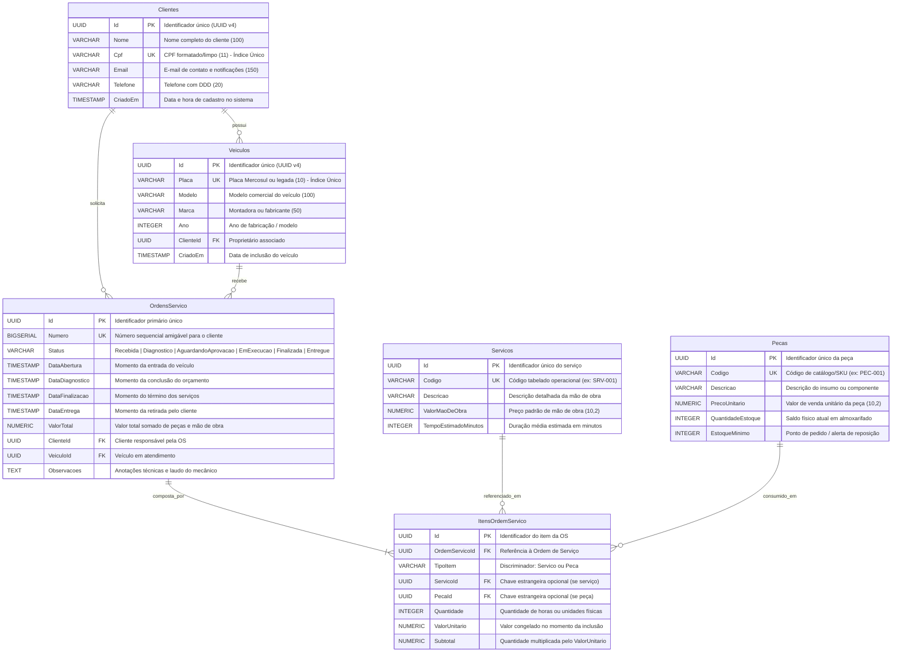
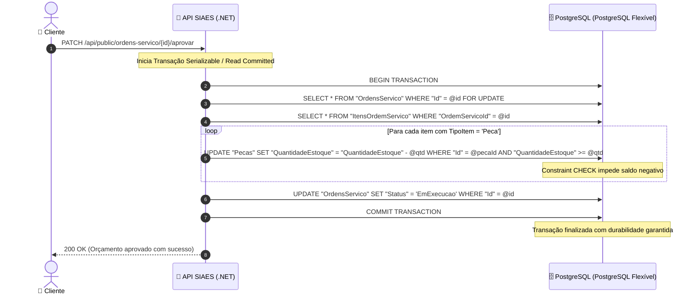

# Modelagem do Banco de Dados Relacional & Justificativa Técnica

Documento formal de arquitetura referente ao banco de dados relacional gerenciado do sistema **SIAES (Oficina Mecânica)**, em atendimento aos requisitos da **Fase 3 do Tech Challenge SOAT - FIAP**.

---

## 🧭 Sumário

1. [Justificativa Formal da Escolha do Banco de Dados](#1-justificativa-formal-da-escolha-do-banco-de-dados)
   - [Por que um Banco Relacional?](#por-que-um-banco-relacional)
   - [Por que PostgreSQL 16 no Azure Database for PostgreSQL?](#por-que-postgresql-16-no-aws-rds)
2. [Evolução e Ajustes no Modelo Relacional (Fase 3)](#2-evolução-e-ajustes-no-modelo-relacional-fase-3)
3. [Diagrama Entidade-Relacionamento (ERD)](#3-diagrama-entidade-relacionamento-erd)
4. [Dicionário de Dados e Especificação de Tabelas](#4-dicionário-de-dados-e-especificação-de-tabelas)
   - [Tabela Clientes](#tabela-clientes)
   - [Tabela Veiculos](#tabela-veiculos)
   - [Tabela Servicos](#tabela-servicos)
   - [Tabela Pecas](#tabela-pecas)
   - [Tabela OrdensServico](#tabela-ordensservico)
   - [Tabela ItensOrdemServico](#tabela-itensordemservico)
5. [Detalhamento dos Relacionamentos e Integridade](#5-detalhamento-dos-relacionamentos-e-integridade)
6. [Estratégia de Indexação e Otimização de Performance](#6-estratégia-de-indexação-e-otimização-de-performance)
7. [Garantias Transacionais ACID no Domínio da Oficina](#7-garantias-transacionais-acid-no-domínio-da-oficina)

---

## 1. Justificativa Formal da Escolha do Banco de Dados

### Por que um Banco Relacional?

O modelo de negócio de uma oficina mecânica exige **consistência imediata e forte integridade referencial**. As operações financeiras e logísticas da oficina apresentam as seguintes características:

1. **Baixa Atômica de Estoque com Alta Concorrência**:
   Quando múltiplas ordens de serviço são aprovadas simultaneamente, o decremento de peças do estoque físico não pode sofrer de *anomalias de concorrência* (como leituras fantasmas ou atualizações perdidas). Bancos NoSQL orientados a documentos com consistência eventual exigiriam mecanismos complexos de *two-phase commit* ou locks distribuídos na camada de aplicação para garantir que o saldo de peças não fique negativo.
2. **Relacionamentos Determinísticos entre Agregados**:
   Um veículo pertence a um cliente proprietário; uma ordem de serviço vincula um cliente e um veículo específico; os itens da ordem de serviço dependem de um catálogo oficial de mão de obra e peças. No modelo relacional, essas regras de integridade são impostas e validadas nativamente pelo próprio motor de banco de dados via *Foreign Keys* e *Check Constraints*.
3. **Imutabilidade e Rastreabilidade Financeira**:
   O cálculo do valor total da ordem de serviço deve manter o registro histórico do valor unitário praticado na data da execução, independentemente de futuros reajustes na tabela de serviços ou no preço de custo das peças.

### Por que PostgreSQL 16 no Azure Database for PostgreSQL?

Dentre os sistemas gerenciadores de banco de dados relacionais (RDBMS), o **PostgreSQL 16** foi selecionado por:

* **Controle de Concorrência Multiversão (MVCC)**: Permite que operações de leitura pesadas (relatórios operacionais, dashboards de tempo médio de OS) ocorram sem travar operações concorrentes de escrita e atualização de status de OS.
* **Tipos de Dados Modernos e Suporte Nativo a UUID**: O suporte a identificadores universais de 128 bits (`UUID v4`) como chaves primárias elimina riscos de ataques de enumeração sequencial (*IDOR*) e permite a geração descentralizada de chaves na camada de aplicação sem dependência de locks de auto-incremento.
* **Índices Parciais e B-Tree Otimizados**: Índices únicos em colunas de alta frequência de busca (ex: `Cpf` para autenticação na Function Serverless e `Placa` do veículo na recepção) garantem tempo de resposta $O(1)$.
* **Excelente Integração com ORM**: Compatibilidade total de primeira classe com o Entity Framework Core 10 (`Npgsql.EntityFrameworkCore.PostgreSQL`), incluindo suporte a conversores de Value Objects e Value Comparers.
* **Operação Gerenciada Corporativa (Azure Database for PostgreSQL)**:
  * **Alta Disponibilidade zone-redundant**: Replicação síncrona com failover automático em menos de 60 segundos sem perda de transações (RPO = 0);
  * **Armazenamento Elástico (Storage Auto-scaling)**: Expansão dinâmica de 20 GiB até 50 GiB sem parada de sistema;
  * **Backups Automatizados Contínuos**: Point-in-Time Recovery (PITR) com retenção de até 35 dias;
  * **Performance Insights**: Monitoramento ativo de consultas lentas (*slow queries*) e estatísticas de I/O em tempo real.

---

## 2. Evolução e Ajustes no Modelo Relacional (Fase 3)

Com a evolução da solução da Fase 2 para a Fase 3, foram implementados os seguintes ajustes na modelagem:

1. **Desacoplamento Completo entre Peças e Serviços nos Itens da OS**:
   - Anteriormente modelados com atributos sobrepostos, agora organizados em uma estrutura clara onde `ItensOrdemServico` possui um discriminador `TipoItem` (`Servico` ou `Peca`) e chaves estrangeiras opcionais apontando para tabelas mestras independentes.
2. **Índice Único Dedicado no CPF do Cliente**:
   - Para atender ao requisito obrigatório de **Autenticação Serverless via CPF**, a coluna `Cpf` da tabela `Clientes` recebeu um índice B-Tree único (`IX_Clientes_Cpf`). Essa otimização garante que a consulta executada pela Function Serverless seja instantânea mesmo com milhões de clientes cadastrados.
3. **Mecanismo de Estoque Mínimo**:
   - Inclusão do campo `EstoqueMinimo` na tabela `Pecas` para alimentar alertas operacionais no dashboard de observabilidade quando o inventário atingir o ponto de reposição preventiva.
4. **Isolamento de Datas Operacionais para SLA**:
   - Criação de marcos temporais independentes na tabela `OrdensServico`: `DataAbertura`, `DataDiagnostico`, `DataFinalizacao` e `DataEntrega`, viabilizando o cálculo exato do tempo médio de execução exigido no monitoramento da Fase 3.

---

## 3. Diagrama Entidade-Relacionamento (ERD)



---

## 4. Dicionário de Dados e Especificação de Tabelas

### Tabela `Clientes`
Representa os clientes e proprietários de veículos cadastrados na oficina mecânica.

| Coluna | Tipo | Nulo? | Restrições / Índices | Descrição |
| :--- | :--- | :--- | :--- | :--- |
| `Id` | `UUID` | Não | **PK** (`uuid_generate_v4()`) | Identificador global único da entidade Cliente. |
| `Nome` | `VARCHAR(100)` | Não | - | Nome completo do cliente. |
| `Cpf` | `VARCHAR(11)` | Não | **UK** (`IX_Clientes_Cpf`) | CPF (11 dígitos numéricos). Chave de busca da Lambda de autenticação. |
| `Email` | `VARCHAR(150)` | Não | - | E-mail para envio de notificações e orçamentos. |
| `Telefone` | `VARCHAR(20)` | Não | - | Telefone de contato para recados e WhatsApp. |
| `CriadoEm` | `TIMESTAMPTZ` | Não | `DEFAULT NOW()` | Carimbo de data/hora de criação do registro. |

### Tabela `Veiculos`
Armazena a frota de veículos atendida pela oficina mecânica.

| Coluna | Tipo | Nulo? | Restrições / Índices | Descrição |
| :--- | :--- | :--- | :--- | :--- |
| `Id` | `UUID` | Não | **PK** | Identificador único do veículo. |
| `Placa` | `VARCHAR(10)` | Não | **UK** (`IX_Veiculos_Placa`) | Placa identificadora do veículo. |
| `Modelo` | `VARCHAR(100)` | Não | - | Modelo do automóvel (ex: Civic Touring 1.5). |
| `Marca` | `VARCHAR(50)` | Não | - | Fabricante / Montadora (ex: Honda, Toyota). |
| `Ano` | `INTEGER` | Não | - | Ano de fabricação do automóvel. |
| `ClienteId` | `UUID` | Não | **FK** -> `Clientes.Id` | Referência ao proprietário do veículo (`ON DELETE CASCADE`). |
| `CriadoEm` | `TIMESTAMPTZ` | Não | `DEFAULT NOW()` | Carimbo de data/hora do cadastro. |

### Tabela `Servicos`
Catálogo de procedimentos e mão de obra tabelada da oficina.

| Coluna | Tipo | Nulo? | Restrições / Índices | Descrição |
| :--- | :--- | :--- | :--- | :--- |
| `Id` | `UUID` | Não | **PK** | Identificador do procedimento técnico. |
| `Codigo` | `VARCHAR(20)` | Não | **UK** (`IX_Servicos_Codigo`)| Código de referência operacional (ex: `SRV-001`). |
| `Descricao` | `VARCHAR(200)` | Não | - | Descrição do serviço (ex: Troca de pastilhas). |
| `ValorMaoDeObra`| `NUMERIC(10,2)`| Não | `CHECK (ValorMaoDeObra >= 0)`| Preço tabelado da mão de obra. |
| `TempoEstimadoMinutos`| `INTEGER` | Não | `DEFAULT 60` | Duração prevista do procedimento em minutos. |

### Tabela `Pecas`
Controle de estoque físico e inventário de autopeças e lubrificantes.

| Coluna | Tipo | Nulo? | Restrições / Índices | Descrição |
| :--- | :--- | :--- | :--- | :--- |
| `Id` | `UUID` | Não | **PK** | Identificador da peça de reposição. |
| `Codigo` | `VARCHAR(20)` | Não | **UK** (`IX_Pecas_Codigo`) | Código de rastreio ou SKU da peça (ex: `PEC-001`). |
| `Descricao` | `VARCHAR(200)` | Não | - | Descrição da peça (ex: Filtro de Óleo Fram). |
| `PrecoUnitario`| `NUMERIC(10,2)`| Não | `CHECK (PrecoUnitario >= 0)` | Preço de venda unitário para o cliente. |
| `QuantidadeEstoque`| `INTEGER` | Não | `CHECK (QuantidadeEstoque >= 0)`| Quantidade física disponível em almoxarifado. |
| `EstoqueMinimo`| `INTEGER` | Não | `DEFAULT 5` | Limite inferior para disparo de alerta de reposição. |

### Tabela `OrdensServico`
Agregado principal do domínio operacional da oficina mecânica.

| Coluna | Tipo | Nulo? | Restrições / Índices | Descrição |
| :--- | :--- | :--- | :--- | :--- |
| `Id` | `UUID` | Não | **PK** | Identificador único universal da OS. |
| `Numero` | `BIGSERIAL` | Não | **UK** | Número sequencial amigável exibido ao cliente. |
| `Status` | `VARCHAR(50)` | Não | `IX_OrdensServico_Status` | Estado da OS no ciclo de vida. |
| `DataAbertura`| `TIMESTAMPTZ` | Não | `DEFAULT NOW()` | Data de entrada do veículo na oficina. |
| `DataDiagnostico`| `TIMESTAMPTZ`| Sim | - | Data de emissão e envio do orçamento ao cliente. |
| `DataFinalizacao`| `TIMESTAMPTZ`| Sim | - | Data de conclusão dos reparos mecânicos. |
| `DataEntrega`| `TIMESTAMPTZ` | Sim | - | Data em que o cliente retirou o veículo. |
| `ValorTotal` | `NUMERIC(12,2)`| Não | `DEFAULT 0.00` | Somatório congelado de serviços e peças aplicadas. |
| `ClienteId` | `UUID` | Não | **FK** -> `Clientes.Id` | Cliente titular da ordem de serviço. |
| `VeiculoId` | `UUID` | Não | **FK** -> `Veiculos.Id` | Veículo em manutenção na OS. |
| `Observacoes`| `TEXT` | Sim | - | Relatório do mecânico e sintomas informados. |

### Tabela `ItensOrdemServico`
Itens e insumos individuais que compõem o escopo de uma OS.

| Coluna | Tipo | Nulo? | Restrições / Índices | Descrição |
| :--- | :--- | :--- | :--- | :--- |
| `Id` | `UUID` | Não | **PK** | Identificador único do item da OS. |
| `OrdemServicoId`| `UUID` | Não | **FK** (`ON DELETE CASCADE`)| Vínculo com a OS correspondente. |
| `TipoItem` | `VARCHAR(20)` | Não | - | Tipo do item: `'Servico'` ou `'Peca'`. |
| `ServicoId` | `UUID` | Sim | **FK** -> `Servicos.Id` | Referência ao serviço (se `TipoItem = 'Servico'`). |
| `PecaId` | `UUID` | Sim | **FK** -> `Pecas.Id` | Referência à peça (se `TipoItem = 'Peca'`). |
| `Quantidade`| `INTEGER` | Não | `CHECK (Quantidade > 0)` | Quantidade aplicada (unidades ou horas). |
| `ValorUnitario`| `NUMERIC(10,2)`| Não | `CHECK (ValorUnitario >= 0)` | Preço unitário no momento da aprovação. |
| `Subtotal` | `NUMERIC(10,2)`| Não | `CHECK (Subtotal >= 0)` | Valor calculado (`Quantidade * ValorUnitario`). |

---

## 5. Detalhamento dos Relacionamentos e Integridade

1. **`Clientes` (1) ---> (N) `Veiculos`**:
   - Um cliente pode registrar múltiplos veículos sob sua titularidade (ex: frotas familiares ou empresariais).
   - O relacionamento é protegido por chave estrangeira com regra `ON DELETE CASCADE`. Se um cliente for excluído, seus veículos correspondentes são purgados atomicamente.
2. **`Clientes` (1) ---> (N) `OrdensServico`** e **`Veiculos` (1) ---> (N) `OrdensServico`**:
   - Uma ordem de serviço vincula estritamente um cliente e um veículo.
   - A exclusão de um cliente ou veículo que possua ordens de serviço históricas é bloqueada pelo motor do PostgreSQL (`RESTRICT` implícito), preservando o histórico legal e contábil.
3. **`OrdensServico` (1) ---> (N) `ItensOrdemServico`**:
   - Composição estrita de agregados no DDD.
   - Caso a ordem de serviço seja cancelada antes da aprovação, a deleção cascateia atomicamente para seus itens componentes (`ON DELETE CASCADE`).

---

## 6. Estratégia de Indexação e Otimização de Performance

Para garantir tempo de resposta previsível e baixa latência de I/O no PostgreSQL Flexível, foram criados índices estratégicos:

```sql
-- Busca instantânea na Lambda de Autenticação (Fase 3)
CREATE UNIQUE INDEX "IX_Clientes_Cpf" ON "Clientes" ("Cpf");

-- Busca rápida de veículo na recepção da oficina
CREATE UNIQUE INDEX "IX_Veiculos_Placa" ON "Veiculos" ("Placa");

-- Aceleração de consultas filtradas por status de atendimento no Quadro Kanban
CREATE INDEX "IX_OrdensServico_Status" ON "OrdensServico" ("Status");

-- Otimização da listagem de ordens de serviço por cliente autenticado
CREATE INDEX "IX_OrdensServico_ClienteId" ON "OrdensServico" ("ClienteId");

-- Otimização de junções no carregamento de itens da OS (Eager Loading no EF Core)
CREATE INDEX "IX_ItensOrdemServico_OrdemServicoId" ON "ItensOrdemServico" ("OrdemServicoId");
```

---

## 7. Garantias Transacionais ACID no Domínio da Oficina

O fluxo operacional de aprovação de orçamento exemplifica o rigor das propriedades ACID asseguradas pelo PostgreSQL:



1. **Atomicidade**: Todas as peças têm seu estoque baixado e o status da OS é atualizado em conjunto. Se faltar saldo de qualquer item, o *rollback* reverte todas as alterações.
2. **Consistência**: A restrição `CHECK (QuantidadeEstoque >= 0)` impede vendas além da disponibilidade física.
3. **Isolamento**: O bloqueio pessimista ou controle otimista com MVCC impede condições de corrida (*race conditions*) se dois atendentes tentarem manipular a mesma peça ao mesmo tempo.
4. **Durabilidade**: Uma vez realizado o `COMMIT`, o log transacional (*Write-Ahead Logging - WAL*) garante persistência mesmo em caso de falha de energia ou reinicialização do nó PostgreSQL Flexível.
